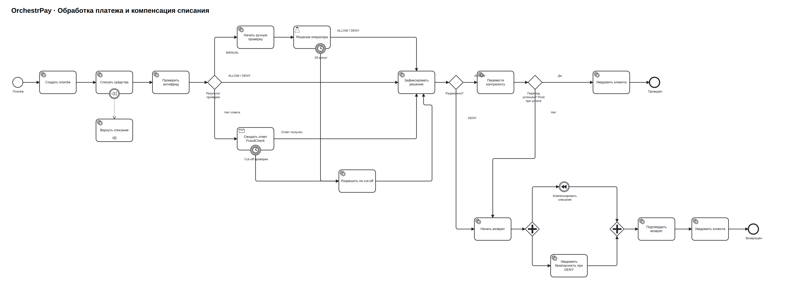

# BPMN платёжного процесса

[PNG](payment-process.png) · [SVG](payment-process.svg) · [PlantUML](payment-process.puml) · [BPMN-код](../Task4.2/process.bpmn)

После списания антифрод возвращает ALLOW, DENY или MANUAL. MANUAL создаёт задачу оператора на 20 минут. При отсутствии ответа Receive Task ждёт сообщение FraudDecision до cut-off. Оба таймера разрешают платёж с источником `cutoff`.

Pivot — подтверждённый перевод. Отказ антифрода или перевода до pivot запускает компенсацию списания.

Boundary event связывает списание с обработчиком «Вернуть списание». Возврат и уведомление безопасности идут параллельно. При отказе перевода без DENY уведомление безопасности пропускается. После подтверждения возврата уведомляется клиент.

Диаграмма показывает исполняемый процесс. Compliance, контроль ограничений и возврат после pivot в него не входят.
